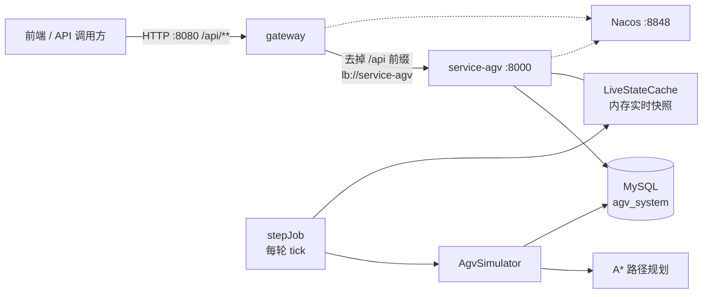
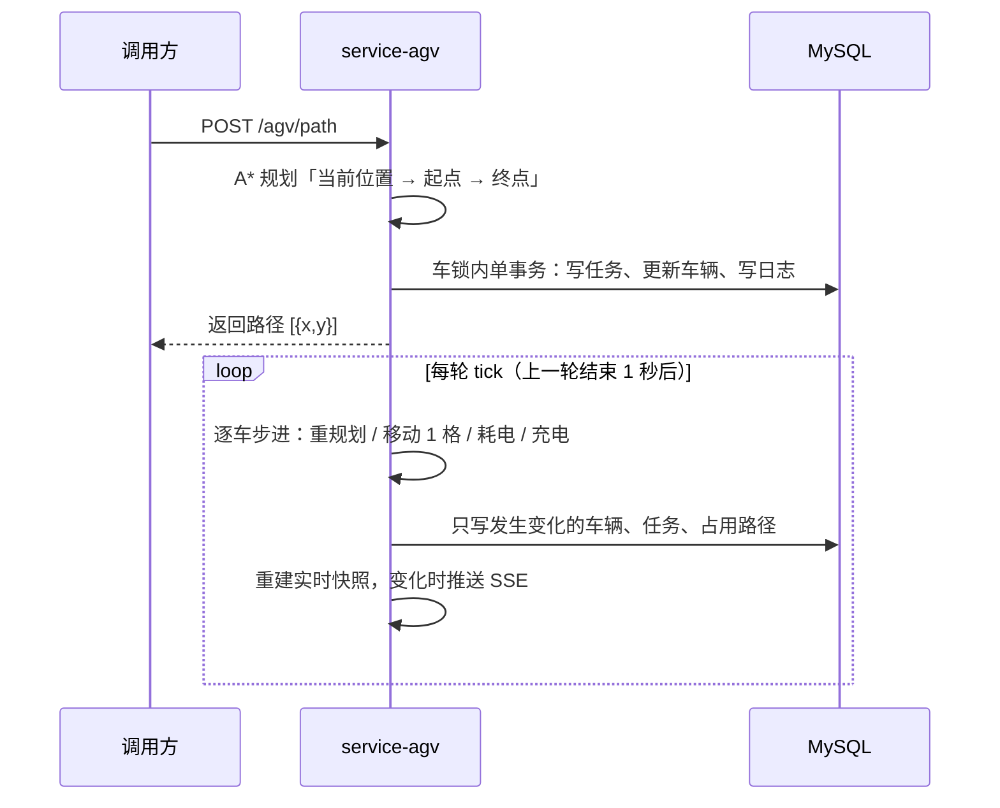

# AGV 智能调度与地图管理系统 · 后端

基于 Spring Boot 3 / Spring Cloud 的 AGV（自动导引车）仿真与调度后端。提供栅格地图版本管理、A* 路径规划、
任务下发与调度、车辆运动 / 耗电 / 自动充电仿真、实时状态推送（ETag 304 + SSE）和运行日志查询，
适合用作 AGV 调度算法的学习、演示与二次开发底座。

> 仓库地址：[GitHub](https://github.com/lizhi-03/agv-system) · [Gitee](https://gitee.com/blood-sugar/agv-map-system)
>
> 配套前端（Vue 3 + TypeScript + Vite 控制台）是独立工程，通过网关 `http://localhost:8080/api` 对接，本文只覆盖后端。

---

## 目录

- [功能概览](#功能概览)
- [技术栈](#技术栈)
- [系统架构](#系统架构)
- [目录结构](#目录结构)
- [快速开始](#快速开始)
- [接口说明](#接口说明)
- [实时数据通道](#实时数据通道)
- [核心机制](#核心机制)
- [配置项](#配置项)
- [测试与验收](#测试与验收)
- [构建与部署](#构建与部署)
- [已知限制](#已知限制)
- [更新记录](#更新记录)

---

## 功能概览

| 模块 | 能力 |
| --- | --- |
| 地图管理 | 栅格地图（宽高、障碍物、站点 / 充电站），保存即生成新版本（`version + 1`，旧版本保留为历史） |
| 车辆管理 | 查询单车 / 全部车辆状态；批量加车（`AGVplus0001` 起连续编号）；启停、调速、上报位置；遥控前往最近充电站 |
| 任务调度 | 下发运输任务（自动规划「当前位置 → 起点 → 终点」）；路径预览（只规划不落库）；分页查询、取消、清空 |
| 路径规划 | A*，四方向移动（可开启八方向）；曼哈顿 / 欧几里得 / 切比雪夫启发函数；行进中按配置间隔重规划 |
| 车辆仿真 | 每轮 tick 每车移动 1 格；按速度耗电；电量 ≤ 30% 自动去最近充电站，每 tick 充 5%，> 95% 结束 |
| 实时推送 | `GET /agv/live` 合并快照 + ETag/304；`GET /agv/stream` SSE 推送（仅变化时推帧，15s 心跳） |
| 日志 | `info` / `warning` / `error` 分级记录，支持级别与关键字过滤分页 |

---

## 技术栈

| 分类 | 技术 / 版本 |
| --- | --- |
| 语言 | Java 17 |
| 框架 | Spring Boot 3.3.4、Spring Cloud 2023.0.3、Spring Cloud Alibaba 2023.0.3.2 |
| 网关 | Spring Cloud Gateway + LoadBalancer |
| 注册 / 配置中心 | Nacos 2.x（本地可用静态服务发现替代，见[快速开始](#方式二不依赖-nacos-启动推荐本地开发)） |
| 持久层 | MyBatis 3.0.3、MyBatis-Plus 3.5.5、PageHelper 1.4.6 |
| 数据库 | MySQL 8.x |
| 工具库 | Lombok、Hutool 5.8.27、Fastjson 1.2.83、Jackson |
| 测试 | JUnit 5、Mockito（Spring Boot Starter Test） |
| 构建 | Maven 3.8+ |
| 已引入但未启用 | Sentinel、Seata（`seata.enabled=false`）、Redis、OpenFeign |

---

## 系统架构



- 外部请求统一走网关 `http://localhost:8080/api/**`，网关用 `RewritePath` 去掉 `/api` 后转发到 `service-agv`。
- 网关负责 CORS 预检应答，并对 SSE 长连接设置 1 小时响应超时。
- `service-agv` 承担全部业务逻辑与车辆仿真；读接口（`/agv/list`、`/agv/live`、`/map/current`）读内存快照，不打数据库。

### 模块

| 模块 | 说明 |
| --- | --- |
| `agv-model` | 公共模型：PO / DTO / Query、`Result` / `PageResult`、MyBatis JSON 类型处理器 |
| `agv-service/service-agv` | 核心服务：Controller、Service、Mapper、A*、仿真、定时任务、实时通道 |
| `gateway` | Spring Cloud Gateway，路由 `/api/**` → `service-agv` |
| `agv/`、`agv-service/agv/` | 构建输出（可执行 jar + 共享 `lib/`），构建生成，不纳入版本库 |

---

## 目录结构

```
agv-system
├── pom.xml                                  # 父工程：依赖版本 + 统一打包配置
├── agv-model/src/main/java/com/lizhi/
│   ├── domain/{po,dto,query}/               # AgvMap / AgvTask / AgvSnapshot / AgvPath / AgvLog / Node ...
│   ├── handler/                             # ListTypeHandler、NodeListTypeHandler（JSON ↔ List）
│   └── result/                              # Result、PageResult
├── agv-service/service-agv/src/
│   ├── main/java/com/lizhi/
│   │   ├── MapMainApplication.java          # 启动类（@EnableScheduling）
│   │   ├── astart/                          # A*：GridMap、AStarSolver、heuristic/
│   │   ├── config/WebConfig.java            # CORS
│   │   ├── controller/                      # /agv、/map、/task、/log、实时通道、全局异常处理
│   │   ├── job/stepJob.java                 # 仿真 tick、自动充电、每日在线车辆统计
│   │   ├── mapper/                          # MyBatis Mapper
│   │   ├── realtime/                        # LiveStateCache、LiveStreamService（SSE）、HttpCacheUtils
│   │   ├── service/impl/                    # 业务实现
│   │   └── utils/
│   │       ├── AgvSimulator.java            # 单车步进：移动、耗电、充电、完成 / 失败
│   │       ├── AgvUnlock.java               # 路径规划（在缓存网格模板的副本上求解）
│   │       ├── AgvLockManager.java          # 每车一把锁 + 锁内事务
│   │       ├── MapCache.java                # 当前地图 / 站点 / 充电点 / 网格模板缓存
│   │       ├── TickContext.java             # 单轮 tick 共享的地图快照与占用路径
│   │       ├── PageBounds.java              # 分页参数边界
│   │       ├── AgvConversion.java           # LinkedHashMap → 强类型对象
│   │       └── AgvCollisionAvoidance.java   # SAT 矩形碰撞检测（未接入仿真）
│   ├── main/resources/
│   │   ├── application.yml                  # 端口、数据源、Nacos、仿真参数
│   │   └── mapper/*.xml
│   └── test/java/com/lizhi/                 # 仿真 / 序列化 / 分页单测 + 数据结构练习
├── gateway/src/main/resources/              # application.yml（8080）、application-route.yml（路由 + CORS）
├── sql/
│   ├── agv_system.sql                       # 建库建表 + 默认 40×30 地图 + 3 台示例车
│   ├── gen-seed.mjs                         # 生成 agv_system.sql 的脚本
│   └── optional_indexes.sql                 # 可选索引（默认不执行）
└── scripts/                                 # 启动、演示数据、接口验收、压测脚本
```

---

## 快速开始

### 1. 环境要求

| 组件 | 版本 | 说明 |
| --- | --- | --- |
| JDK | 17+ | 编译目标为 17，JDK 8 / 11 无法编译 |
| Maven | 3.8+ | |
| MySQL | 8.x | 默认库名 `agv_system` |
| Nacos | 2.x | 仅[方式一](#方式一使用-nacos)需要 |
| Node.js | 18+ | 仅运行 `scripts/*.mjs` 验收 / 压测脚本时需要 |

### 2. 初始化数据库

```bash
mysql -uroot -p --default-character-set=utf8mb4 < sql/agv_system.sql
```

脚本会创建 `agv_map`、`agv_snapshot`、`agv_task`、`agv_path`、`agv_log` 五张表，并写入一份默认地图
（40×30 栅格，8 组货架、6 个作业站点 S1–S6、2 个充电站 C1 / C2）和 3 台示例车辆，启动后即可直接下发任务。

### 3. 编译

仓库不包含可执行 jar（`agv/`、`agv-service/agv/` 已在 `.gitignore` 中排除），启动前需先在本地构建：

```bash
mvn -DskipTests clean package
```

| 产物 | 路径 |
| --- | --- |
| 业务服务 | `agv-service/agv/service-agv-1.0-SNAPSHOT.jar`（依赖在同级 `lib/`） |
| 网关 | `agv/gateway-1.0-SNAPSHOT.jar`（依赖在同级 `lib/`） |

### 4. 启动

#### 方式一：使用 Nacos

1. 启动 Nacos 单机版：`startup.cmd -m standalone`（Windows）或 `sh startup.sh -m standalone`（Linux / macOS）。
2. 按需修改 `agv-service/service-agv/src/main/resources/application.yml` 中的数据库账号与 Nacos 地址。
3. 先启动业务服务，再启动网关：

```bash
java -jar agv-service/agv/service-agv-1.0-SNAPSHOT.jar --spring.datasource.password=<你的密码>
```

```bash
java -jar agv/gateway-1.0-SNAPSHOT.jar
```

#### 方式二：不依赖 Nacos 启动（推荐本地开发）

用 Spring Cloud 的静态服务发现代替 Nacos。Windows 下可直接用脚本（业务服务 18000、网关 8080）：

```powershell
$env:AGV_MYSQL_PASSWORD = '<你的密码>'
powershell -ExecutionPolicy Bypass -File scripts\start-backend.ps1
```

数据库密码只从环境变量 `AGV_MYSQL_PASSWORD` 或 `-MysqlPassword` 参数读取，缺省时交互式输入，不会写入仓库。
其它系统可以手动启动，等价参数如下：

```bash
java -jar agv-service/agv/service-agv-1.0-SNAPSHOT.jar \
  --server.port=18000 \
  --spring.datasource.password=<你的密码> \
  --spring.cloud.nacos.discovery.enabled=false \
  --spring.cloud.nacos.config.enabled=false \
  --spring.cloud.service-registry.auto-registration.enabled=false \
  --spring.cloud.sentinel.eager=false
```

```bash
java -jar agv/gateway-1.0-SNAPSHOT.jar \
  --spring.cloud.nacos.discovery.enabled=false \
  --spring.cloud.service-registry.auto-registration.enabled=false \
  "--spring.cloud.discovery.client.simple.instances.service-agv[0].uri=http://localhost:18000"
```

### 5. 验证

```bash
curl -X POST http://localhost:8080/api/agv/list
```

可选：写入演示数据（2 条运输任务 + 1 条充电任务）：

```bash
node scripts/seed-demo.mjs
```

---

## 接口说明

经网关访问时在路径前加 `/api`，例如 `POST http://localhost:8080/api/agv/path` 转发到 `service-agv` 的 `POST /agv/path`。

### 统一响应

```json
{ "code": 200, "msg": null, "data": {} }
```

| 情况 | HTTP | `code` | 说明 |
| --- | --- | --- | --- |
| 成功 | 200 | `200` | |
| 业务失败 | 200 | `204` | `msg` 为原因：参数缺失、车辆不存在、无任务可启停、路径规划失败、JSON 解析失败等 |
| 分页 | 200 | `200` | `data` 为 `{ "total": 100, "records": [...] }` |

例外：`GET /agv/live` 直接返回快照对象，不套 `Result` 壳；`/agv/live`、`/map/current` 可能返回 HTTP 304。

### 车辆与任务 `/agv`

| 方法 | 路径 | 说明 | 请求体 |
| --- | --- | --- | --- |
| POST | `/agv/list` | 全部车辆状态（读内存快照） | - |
| GET | `/agv/{agvCode}` | 单车状态及其占用路径 | - |
| POST | `/agv/batch/{n}` | 批量加车，`n` 取 1–50，返回新编号 `string[]` | - |
| POST | `/agv/path` | 下发任务并开始执行，返回规划路径 `[{x,y}]` | `AgvTaskDTO` |
| POST | `/agv/preview` | 只规划路径，不建任务、不改车辆、不写库 | `AgvTaskDTO` |
| POST | `/agv/stop` | 暂停（车辆须有任务） | `{ "agvCode" }` |
| POST | `/agv/start` | 恢复（车辆须有任务） | `{ "agvCode" }` |
| POST | `/agv/speed` | 调速，`speed` 取 0–1000 cm/s | `{ "agvCode", "speed" }` |
| POST | `/agv/report` | 上报状态，**只覆盖请求中出现的字段** | `AgvSnapshotDTO` |
| POST | `/agv/charge/{agvCode}` | 前往最近可达充电站（会取消当前任务） | - |
| POST | `/agv/clear` | 取消全部任务，所有车辆复位为空闲 | - |
| GET | `/agv/live` | 合并实时快照，见[实时数据通道](#实时数据通道) | - |
| GET | `/agv/stream` | SSE 实时推送 | - |
| GET | `/agv/stream/status` | 当前 SSE 连接数 | - |

下发任务示例（`currentPoint` 可省略，省略时取车辆当前位置；`taskCode` 可省略，最长 64 字符）：

```json
{
  "agvCode": "AGV001",
  "taskCode": "T20261118001",
  "startPoint": { "id": "S1", "x": 2, "y": 2 },
  "endPoint":   { "id": "S6", "x": 37, "y": 27 },
  "currentPoint": { "x": 2, "y": 1 }
}
```

当前位置与起点不同时，车辆先开到起点再前往终点。路径节点只包含坐标：`[{"x":2,"y":1},{"x":2,"y":2},...]`。

### 地图 `/map`

| 方法 | 路径 | 说明 |
| --- | --- | --- |
| GET | `/map/current` | 当前地图（含障碍、站点、占用路径）；支持 `If-None-Match` 或 `?version=` 命中返回 304 |
| POST | `/map/save` | 保存为新版本，缺省字段继承当前版本 |
| POST | `/map/reset` | 返回当前地图（不做写操作） |
| GET | `/map/station` | 当前地图站点列表（`type` 为 `station` 或 `charge`） |

### 任务与日志

| 方法 | 路径 | 说明 |
| --- | --- | --- |
| POST | `/task/page` | 任务分页，过滤：`taskCode`（模糊）、`status`、`agvCode` |
| GET | `/task/cancel/{taskId}` | 取消任务，车辆复位为空闲 |
| POST | `/log/page` | 日志分页，过滤：`level`、`message`（模糊） |

分页规则：`page` 小于 1 按第 1 页；`pageSize` 缺省 10、上限 100（超出按 100 截断）；`taskCode` 超过 64 字符返回业务错误。

### 状态取值

| 对象 | 字段 | 取值 |
| --- | --- | --- |
| 车辆 | `status` | `idle` 空闲 · `running` 行驶 · `stopping` 暂停 · `charging` 充电中 |
| 车辆 | `isCharge` | `0` 普通 · `1` 正在执行充电任务 |
| 任务 | `status` | `processing` · `paused` · `completed` · `failed` · `cancelled` |
| 任务 | `taskType` | `物料运输` · `充电` |
| 日志 | `level` | `info` · `warning` · `error` |

---

## 实时数据通道

仿真每轮 tick 结束、以及每个写接口返回前，都会重建一次内存快照 `LiveStateCache` 并计算内容指纹（etag）。
因此**写接口返回后立即读，一定能读到新状态**。

### `GET /agv/live`

```json
{
  "timestamp": "2026-11-18T08:00:00Z",
  "etag": "\"a67f47fb...\"",
  "map":   { "mapId": 1, "mapName": "默认仓储地图", "version": 1, "width": 40, "height": 30 },
  "cars":  [{ "agvCode": "AGV001", "x": 2, "y": 1, "status": "running", "battery": 87.5,
              "taskId": 12, "pathIndex": 3, "plannedPath": [{ "x": 2, "y": 1 }], "...": "..." }],
  "paths": [{ "agvCode": "AGV001", "x": 2, "y": 2, "type": "path" }]
}
```

带 `If-None-Match: <上次的 etag>` 请求时，内容未变返回 **HTTP 304**（无 body）。轮询时空闲场景基本全是 304。

### `GET /agv/stream`（SSE）

- 事件名 `state`，`data` 与 `/agv/live` 结构相同；连接建立后先推一帧当前快照。
- 只在 etag 变化时推帧，每轮 tick 最多一帧；每 15 秒发一次注释行心跳。
- 单连接 30 分钟超时，浏览器 `EventSource` 会自动重连。

```js
const es = new EventSource('http://localhost:8080/api/agv/stream')
es.addEventListener('state', (e) => render(JSON.parse(e.data)))
```

---

## 核心机制

### 任务执行流程



### A* 路径规划

1. 从 `MapCache` 取当前地图的网格模板并复制一份：障碍物、站点不可通行（权重 `-1`），起点与终点设为可通行。
2. `AStarSolver` 按 `f = g + h` 扩展节点；直线移动用曼哈顿距离、对角移动用欧几里得距离计算 `g`，`h` 用曼哈顿距离。
3. 到达终点后沿 `parent` 回溯得到路径。`parent` / `g` / `h` / `cost` 只在算法内部使用，接口响应与 `planned_path` 列只保留坐标。
4. 无解时写一条 `error` 日志：下发任务接口返回业务错误；仿真中则把该任务置为 `failed` 并复位车辆，不影响其它车辆。

### 车辆仿真

- **移动**：每轮 tick 最多 1 格，方向角按八方向更新。
- **耗电**：非空闲时每轮减 `max(0.1, speed / 1000)`。
- **自动充电**：电量 ≤ 30% 且不在充电任务中时，调用充电服务前往最近可达充电站；失败后按冷却时间（默认 5 秒）再试。
- **充电**：到达充电站转为 `charging`，每轮 +5%，超过 95% 后任务完成、车辆转为空闲。

### 仿真循环与并发模型

每轮 tick（`stepJob.steploop`）：读一次全部车辆 → 准备 `TickContext`（地图取缓存、占用路径整轮只查一次）→
逐车 `AgvSimulator.step` → 重建一次实时快照。调度使用 `fixedDelay`，上一轮结束 1 秒后才开始下一轮，不会重叠或补拍。

- **每车一把锁**：`AgvLockManager` 为每台车维护一把可重入锁。tick 步进以及下发任务、充电、启停、调速、上报、取消、
  清空等所有写车辆状态的入口，都先拿车锁再"读 → 算 → 写"。写请求只和同一台车互斥，不会被整轮 tick 阻塞，
  tick 也不会用旧数据覆盖刚下发的任务。
- **先锁后事务**：多表写（任务 / 车辆 / 日志 / 占用路径）在车锁内的同一事务完成，失败整体回滚；保存地图同样在单事务内完成。
- **只写变化**：步进前后比较车辆与任务，无变化不发 UPDATE；`lastUpdate` 表示状态最后一次变化的时间。
- **占用路径**：只在重规划时重写，1 次 delete + 1 次批量 insert（每批最多 500 点）。
- **地图缓存**：缓存当前地图、站点、充电点和网格模板；TTL 到期后只查版本指纹（`map_id` / `version` / `updated_at`），保存地图后立即失效。
- **单车容错**：某台车步进异常只回滚并跳过这台车，其它车辆照常推进。

> **扩展注意**：新增任何写 `agv_snapshot` 的代码都必须经过 `AgvLockManager`，否则会重新出现 tick 覆盖写入的问题。

性能实测（MySQL 8.0，20 台车 / 10 台运行，`scripts/bench-tick.mjs`，30 秒）：

| 指标 | 优化前 | 优化后 |
| --- | --- | --- |
| tick 耗时 p50 / p95 | 1017 ms / 1482 ms | 95 ms / 155 ms |
| INSERT / 秒 | 440 | 10 |
| SELECT / 秒 | 611 | 120 |
| `/agv/path` 最大响应体 | 241.7 KB | 2.0 KB |

绝对值与磁盘 fsync 速度有关，请在目标环境用同一脚本复测。

---

## 配置项

`agv-service/service-agv/src/main/resources/application.yml`，均可用 `--key=value` 启动参数覆盖：

| 配置项 | 默认值 | 说明 |
| --- | --- | --- |
| `server.port` | `8000` | 业务服务端口 |
| `spring.datasource.url` | `jdbc:mysql://localhost:3306/agv_system?...` | 数据库地址 |
| `spring.datasource.username` / `password` | `root` / `root` | 数据库账号，生产环境请改用环境变量 |
| `spring.cloud.nacos.server-addr` | `127.0.0.1:8848` | Nacos 地址 |
| `agv.sim.tick-delay-ms` | `1000` | 上一轮 tick 结束到下一轮开始的间隔 |
| `agv.sim.replan-every-cells` | `1` | 每走几格重规划一次。`1` 为每轮都重规划；大于 1 时走满 N 格、下一格被其它车占用或车辆偏离路径才重规划 |
| `agv.sim.dirty-check` | `true` | `false` 时每轮都写车辆与任务（旧行为） |
| `agv.sim.auto-charge-cooldown-ms` | `5000` | 同一台车两次自动充电尝试的最小间隔 |
| `agv.sim.map-cache-ttl-ms` | `1000` | 地图缓存多久检查一次版本指纹 |

网关（`gateway/src/main/resources/`）：端口 `8080`；路由 `/api/** → lb://service-agv`；CORS 全放开；
`httpclient.response-timeout: 1h` 保证 SSE 长连接不被网关断开。

---

## 测试与验收

### 单元测试

```bash
mvn test
```

| 测试类 | 覆盖内容 |
| --- | --- |
| `agv/AgvSimulatorTest` | 空闲车不写库、逐格移动与完成、先经取货点、路径丢失 / 无解、重规划间隔、偏离路径立即重规划、充电全过程、已删除车辆不回写 |
| `agv/GridMapAndPageBoundsTest` | 网格副本与模板隔离、分页边界 |
| `handler/NodeJsonTest` | `Node` 响应与落库格式只含 `x` / `y`，兼容旧格式反序列化 |
| `method/**`、`test.java` | 数据结构练习（链表、队列、堆、树、哈希表等），与业务无关 |

### 接口验收与压测

需要服务已启动。脚本默认访问网关 `http://localhost:8080/api`，可用 `AGV_API_BASE` 改为直连业务服务。
**脚本会加车、下发并清空任务，请在测试库上运行。**

| 脚本 | 用途 |
| --- | --- |
| `scripts/verify-api-v2.mjs` | 接口回归：分页过滤、批量加车、路径预览不落库、新车可执行任务、CORS |
| `scripts/verify-realtime.mjs` | 实时通道：`/agv/live` 304、SSE 帧率与心跳、写后立即读一致性 |
| `scripts/verify-api.mjs`、`scripts/verify-backend-fixes.mjs` | 早期版本的接口与缺陷修复回归 |
| `scripts/bench-tick.mjs` | tick 压测：tick 耗时分位、每秒 SQL 语句数、写 / 读接口延迟 |
| `scripts/seed-demo.mjs` | 写入演示任务 |

```bash
node scripts/verify-api-v2.mjs
```

```bash
node scripts/verify-realtime.mjs
```

压测示例（直连业务服务；设置 `AGV_LOG_FILE` 可解析 tick 耗时，需开启 `--logging.level.com.lizhi.job=debug`；
设置 `AGV_MYSQL_PASSWORD` 可采集 MySQL 语句计数）：

```bash
AGV_API_BASE=http://localhost:18000 BENCH_CARS=20 BENCH_RUNNING=10 BENCH_SECONDS=30 node scripts/bench-tick.mjs
```

验收脚本的结果明细写入 `.verify/`（已在 `.gitignore` 中）。

---

## 构建与部署

根 `pom.xml` 统一了打包方式：

- `maven-dependency-plugin` 在 `package` 阶段把依赖复制到 `${boot-jar-output}/lib`；
- `maven-jar-plugin` 在 `MANIFEST.MF` 中把 `Class-Path` 指向 `lib/`；
- `spring-boot-maven-plugin` 以 ZIP 布局打包且不内嵌第三方依赖。

所以部署时要保持 **jar 与同级 `lib/` 的相对位置不变**：

```
deploy/
├── gateway/
│   ├── gateway-1.0-SNAPSHOT.jar
│   └── lib/
└── service-agv/
    ├── service-agv-1.0-SNAPSHOT.jar
    └── lib/
```

修改输出目录请调整根 `pom.xml` 的 `boot-jar-output` 属性。

---

## 已知限制

- **无鉴权**：接口没有登录与权限校验，CORS 全放开，请勿直接暴露到公网。
- **车辆之间不避让**：规划时其它车辆的占用路径按可通行处理，多车路径可以重叠。启用真正的避让需要同时设计对向会车与死锁处理。
- **单实例**：车锁、地图缓存、自动充电冷却都在进程内，多实例部署需换成分布式锁与共享缓存。
- **tick 周期会顺延**：实际周期为 1 秒加本轮耗时，负载高时车辆移动节奏变慢，不补拍。
- **地图保存依赖当前版本**：`/map/save` 以现有 `is_current = 1` 的地图为基础，空库需先执行 `sql/agv_system.sql`。
- **碰撞检测未接入**：`AgvCollisionAvoidance` 只是工具类，仿真循环未调用。
- **仿真逻辑**：移动、耗电、充电均为模拟，接入真实车辆需替换 `AgvSimulator` 与车辆控制层。
- **时间口径不统一**：`lastUpdate` 是 UTC 的 ISO8601 字符串，任务与日志时间是服务器本地时间的 `DATETIME`。
- **端口冲突**：Sentinel Dashboard 默认配置为 `localhost:8080`，与网关同端口，启用 Sentinel 前需改其中一个。
- **默认凭据**：`application.yml` 中数据库账号为 `root/root`，仅供本地开发。
- **可选索引**：任务 / 日志数据量增大后，可评估执行 `sql/optional_indexes.sql`（表结构变更，默认未执行）。

---

## 更新记录

### 2026-11 · 仿真循环性能优化

- 全局锁改为每车一把锁；多表写加事务；车辆 / 任务只写变化；地图与寻路网格缓存；占用路径批量写入。
- 自动充电由服务内 HTTP 自调用改为本地调用并加冷却；tick 调度由 cron 改为 fixedDelay。
- 新增 `agv.sim.*` 配置项、仿真单元测试与 `scripts/bench-tick.mjs`。
- 行为变化：路径节点只返回 `x` / `y`；分页 `pageSize` 上限 100；空闲车 `lastUpdate` 不再每秒刷新；
  A* 无解只让该任务失败，不再中断整轮 tick；充电任务记录实际前往的充电站。

### 2026-11 · V2 / V2.1 前端联调

- 新增路径预览 `/agv/preview`、实时快照 `/agv/live`（304）、SSE `/agv/stream`。
- 批量加车改为连续编号并直接入库；任务 / 日志分页支持服务端过滤。
- 修复 `/agv/report` 清空任务、`Node` 反序列化 500、空路径 NPE、无任务启停 500、CORS 预检等问题。
- 新增 `sql/agv_system.sql` 与无 Nacos 启动脚本 `scripts/start-backend.ps1`（密码从环境变量读取）。

---

## License

本项目尚未声明开源许可证；如需对外分发，请先补充 `LICENSE` 并确认依赖许可证兼容性。
